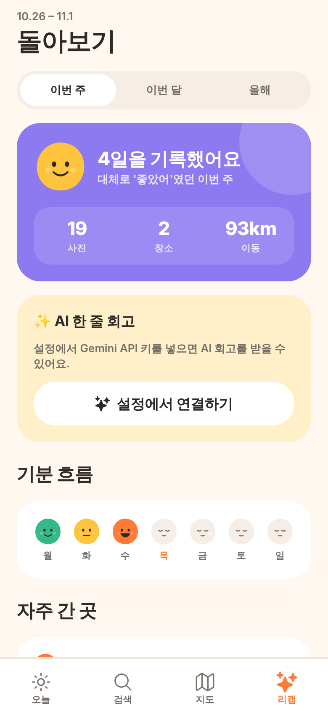

# 하루 (Haru)

사진으로 하루를 기록하고, 사진 내용으로 검색하는 모바일 앱이에요. 아이폰과 안드로이드 모두 Expo로 만들었어요.

<p>
  
  
  
  
</p>

> 화면 이미지는 샘플 데이터로 찍은 미리보기예요.

## 주요 기능

| 탭 | 하는 일 |
|---|---|
| **오늘** | 오늘 찍은 사진을 시간·장소별 "순간"으로 묶은 타임라인, 기분 기록과 한 줄 메모, 1년 전 오늘 |
| **검색** | "부산 바다", "지난주 카페", "케이크"처럼 사진 **내용**·장소·날짜로 검색 (Gemini Embedding 2) |
| **지도** | 사진이 찍힌 장소를 지도에 표시하고, 장소별 사진 모아 보기 |
| **리캡** | 이번 주·달·해 단위 통계(사진, 장소, 이동 거리), 기분 흐름, 자주 간 곳, 하이라이트, AI 회고 |

하단바 위로는 작은 귤 캐릭터(Lottie)가 걸어 다녀요. 기기에서 "동작 줄이기"를 켜 두면 가만히 서 있어요.

## 실행하기

```bash
npm install
```

```bash
npx expo start
```

휴대폰에 **Expo Go** 앱을 설치한 뒤 터미널에 나온 QR 코드를 찍으면 바로 실행돼요. 이 앱에서 쓰는 모듈은 모두 Expo Go에 들어 있어요.

> 앱스토어용 빌드나 개발용 빌드가 필요하면 `npx eas-cli@latest build`를 쓰세요.
> 안드로이드에서 지도를 실제 배포하려면 Google Maps API 키가 필요해요.

## 사진 내용 검색 켜기

1. [Google AI Studio](https://aistudio.google.com/apikey)에서 무료 API 키를 받아요.
2. 앱의 **설정**(오늘 탭 오른쪽 위 톱니바퀴)에 키를 붙여 넣어요. 키는 기기의 보안 저장소에만 저장돼요.
3. **새 사진 정리하기**를 누르면 사진마다 AI 분석이 진행돼요. 끝나면 검색 탭에서 단어로 사진을 찾을 수 있어요.

다른 사람과 앱을 공유할 때는 키를 앱에 넣지 말고, 작은 서버를 거치게 하세요.

```bash
GEMINI_API_KEY=발급받은키 npm run server
```

그런 다음 `.env.example`을 `.env.local`로 복사하고 `EXPO_PUBLIC_API_URL`에 서버 주소를 적어요.

## 동작 방식

1. **사진 읽기**: `expo-media-library`로 사진첩의 날짜와 GPS 위치를 읽어 기기 안 SQLite에 저장해요.
2. **장소 이름**: 좌표를 약 1km 단위로 묶고, 휴대폰의 지오코더로 "서울 성동구" 같은 이름을 붙여요.
3. **AI 분석**: 사진을 512px로 줄여 Gemini Embedding 2로 보내고, 768차원 벡터를 받아 기기에 저장해요.
4. **검색**: 검색어에서 날짜("지난주", "3월")와 장소("부산")를 먼저 골라내요. 남은 단어("바다")만 벡터로 바꿔 저장된 사진 벡터와 비교해요. 비교는 기기 안에서 해요.
5. **비슷한 사진**: 사진 상세 화면에서 이미 저장된 벡터끼리 비교해요. 추가 API 호출은 없어요.
6. **AI 회고**: 사진은 보내지 않아요. 장소·기분·메모 요약만 Gemini에 보내요.

## 폴더 구조

```
src/app/            화면 (Expo Router)
  (tabs)/           오늘 · 검색 · 지도 · 리캡
  day/[date].tsx    날짜별 기록
  photo/[id].tsx    사진 상세 + 비슷한 사진
  settings.tsx      API 키, 사진 범위
src/components/     블롭 캐릭터, 카드, 사진 그리드, 걷는 캐릭터 등
src/lib/            DB, 사진 분석기, 검색어 해석, 리캡 계산, Gemini 연결
assets/lottie/      걷는 캐릭터 애니메이션
scripts/            캐릭터 애니메이션 생성 스크립트
server/             API 키를 숨기는 작은 프록시 서버
```

캐릭터 모양이나 색을 바꾸려면 `scripts/make-walker-lottie.mjs`를 고친 뒤 `npm run make:walker`를 실행하세요. [LottieFiles](https://lottiefiles.com)에서 받은 다른 캐릭터 JSON으로 `assets/lottie/walker.json`을 바꿔도 돼요.

## 알아 둘 점

- 사진 분석은 앱이 켜져 있는 동안 진행돼요. 사진이 많으면 처음 한 번은 시간이 걸려요.
- 사진 내용 검색을 쓰면 축소된 사진이 Google로 전송돼요.
- 디자인은 차분한 명상 앱 스타일(따뜻한 크림 배경, 둥근 카드, 블롭 캐릭터)을 참고했어요. 로고와 일러스트는 모두 새로 만들었어요.
